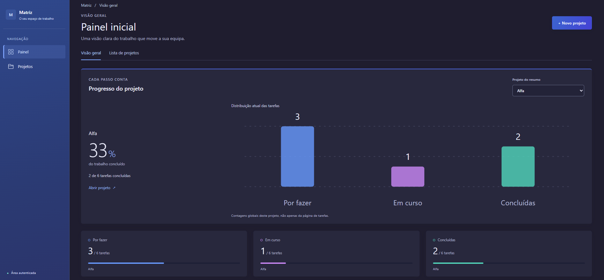

<h1 align="center"></h1>


Aplicação académica de gestão de projetos e tarefas, desenvolvida na formação
AI-Powered Software Engineering com apoio de IA e decisões humanas.
Organiza projetos, participantes e tarefas com vários responsáveis, comentários,
anexos, relações de bloqueio e acompanhamento do progresso.

**Demonstração no Render:** [Abrir a Matriz](https://matriz-demo-h27u.onrender.com/).



---

## Estado

Candidato académico **`0.4.0-rc.1`**, com [pré-release técnica de teste GHCR publicada](docs/verification.md#current-publication), sem release estável. Registo académico e usabilidade implementados; T024 fechada,
28/28 tarefas, full E2E 11/11 PASS documentado em 18-11-2026.
Aprovação visual humana registada separadamente.
[Evidência, proveniência e pendências](docs/verification.md).
Não é um serviço pronto para produção; usar apenas dados fictícios.

---

## Tecnologias

- **Backend:** Java 21, Spring Boot 4.0.9 e Spring Security; sessão local com CSRF.
- **Interface:** React 19.2, TypeScript e Vite.
- **Dados:** PostgreSQL 17, JDBC e migrations Flyway.
- **Execução:** Docker Compose; monólito modular com interface e API no mesmo JAR.

---

## Executar localmente

Pré-requisitos: Git e Docker com Compose. Obter o código:

```powershell
git clone https://github.com/Fibigor/matriz-ai-powered.git
Set-Location matriz-ai-powered
```

Na raiz do repositório, preparar a configuração **apenas se `.env` não existir**:

```powershell
if (-not (Test-Path -LiteralPath .env)) {
    Copy-Item .env.example .env
}
docker compose -p matriz-ficha3 --env-file .env config --quiet
```

O exemplo contém configuração fictícia local. `POSTGRES_PASSWORD` deve ter valor:
é usado **pela base de dados e pela aplicação**; definir só `DATABASE_PASSWORD`
no `.env` não basta. Se `.env` já existir, não o substituir nem partilhar.
Num volume já inicializado, manter a palavra-passe original: alterar a variável
não altera a credencial guardada no PostgreSQL. **Não apagar o volume para corrigir isso.**

Após validação sem erros:

```powershell
docker compose -p matriz-ficha3 --env-file .env up --build -d
```

Abrir **http://localhost:8080**. Por omissão, app e PostgreSQL são publicados
apenas em loopback (8080 e 55432). Flyway aplica V1–V4; o volume conserva dados.
O seed fictício é **opt-in** (`DEMO_ENABLED=true`), não redefine dados/credenciais
existentes. Não editar migrations aplicadas nem usar `docker compose down -v`.

Parar e retomar os contentores existentes sem eliminar dados:

```powershell
docker compose -p matriz-ficha3 stop
docker compose -p matriz-ficha3 start
```

---

## Utilizar

No login, escolher **Criar conta**. O registo é exclusivamente académico:
conta ativa sem confirmação por email, sucesso regressa ao login
**sem auto-login**; é necessário iniciar sessão explicitamente.
Não há recuperação de palavra-passe. Uma conta nova não herda projetos ou
participações, mas pode criar projetos após login.

O gestor gere projeto, membros por email completo e atribuições; participantes
ativos gerem tarefas e comentam. A API controla permissões, não apenas os botões.
Tarefas têm estado, prioridade, chave `MAT-n`, tipo, templates, Markdown básico,
anexos e histórico; bloqueadores pendentes podem impedir a conclusão.

---

## Documentação e desenvolvimento

- [Requisitos](docs/requirements.md), [restrições e decisões pendentes](docs/constraints.md)
  e [User Stories](docs/user-stories.md).
- [Arquitetura](docs/architecture.md), [dados](docs/database.md),
  [ADRs](docs/adr/README.md) e [OpenAPI](openapi.yaml).
- [Desenvolvimento](docs/development.md): execução direta, testes, agentes/Spec Kit,
  observabilidade local, CI e limites da demonstração Render.
- [Verificação atual e histórico](docs/verification.md),
  [plano de testes](docs/test-plan.md) e [referências UI](docs/ui/README.md).
- [Rastreabilidade académica](docs/coursework-review.md),
  [relatório final](docs/relatorio-final.md),
  [guião de apresentação](docs/presentation-script.md),
  [changelog](CHANGELOG.md) e [release notes](RELEASE_NOTES.md).

Agentes devem começar pelo [AGENTS.md](AGENTS.md). CI mantém uma
[exceção temporária exata](docs/constraints.md)
para um HIGH de desenvolvimento até **2026-11-25T00:00:00Z exclusivo**;
não é scan limpo nem remediação.

<a id="observabilidade-local--opt-in"></a>

**Observabilidade local — opt-in:** procedimentos e limites foram movidos para
[o guia de desenvolvimento](docs/development.md#observabilidade-local).
Só o perfil `observability` configura logs de consola JSON ECS nativos do Boot.
O [workflow de prerelease de teste](docs/development.md#prerelease-de-teste-ghcr)
tem [publicação de teste GHCR confirmada por evidência recebida](docs/verification.md#current-publication);
não é release estável nem prova de validação do digest reconstruído pelo CI.
Este ajuste documental é posterior ao commit/imagem publicados e não os integra.
