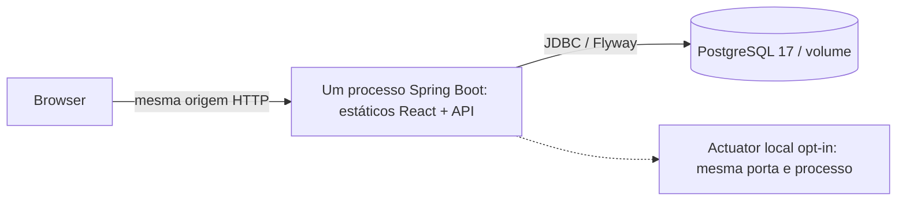
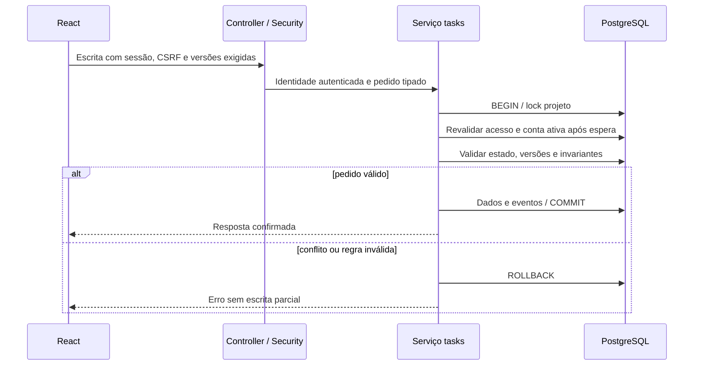

# Matriz — Arquitetura atual

**Leitura do código em 17-11-2026**, incluindo registo académico T1/T2 na worktree sobre HEAD `33dee9bc748126573d52914a86a34861a558b2e4` (a consolidação anterior observou `778ffd1ff8cfa366b444edbb0cc21bcc9f9b28d2`). Documentação do âmbito aprovado pelo autor (ficha 03, extensões de 13-11 e registo de 17-11), não validação pelo cliente. Naquela leitura, candidato `0.4.0-rc.1` sem nova release/publicação da alteração; estado histórico, atualizado pelo suplemento abaixo. [Proveniência/arquivo V1](architecture/README.md), [dados/ER](database.md), [OpenAPI](../openapi.yaml) e [ADRs](adr/README.md).

## Desenho e responsabilidades

**Estado atual — feature 002, 19-11-2026:** leitura estática sobre HEAD
`7c182edf7fe1c2cd1009743b029e3cd9d5759c12`. IN_REVIEW persistido e
Progress.inReview implementados; alinhamento canónico antecipado por
aprovação excecional, **sem aprovação G3/G4/G5 ou fecho**.
[Evidência e pendências](verification.md#feature-002).
A publicação GHCR e o fecho de 001 abaixo são anteriores, não incluem 002
nem provam a geometria/teclado ou persistência após reinício do novo estado.
Sem versão/tag nova ou alteração de stack, segurança, endpoints e permissões.

**Suplemento atual — 18-11-2026:** usabilidade autorizada pelo autor; candidato `0.4.0-rc.1` sem bump, com [pré-release técnica de teste GHCR publicada](verification.md#current-publication), confirmada por evidência recebida, não release estável ou produção. Este ajuste documental é posterior ao commit/imagem publicados e não os integra. **T024 fechada, 28/28**, full E2E **11/11 PASS às 11:55–11:56 UTC**, revisão `review-t024-full-closure` PASS e gates B5/T028 PASS documentados. Visual humano aprovado às 09:42:49Z separadamente. Backend 58/frontend 141/build anteriores e seleção 74/build da correção de foco não foram reexecutados nesta revisão. A leitura datada de abertura mantém a proveniência; [resumo vigente](verification.md#estado-vigente--18-11-2026).

- [Emails.java](../backend/src/main/java/pt/matriz/common/Emails.java) concentra normalização pura `String.trim().toLowerCase(Locale.ROOT)` e validade (regex Unicode compatível/254 unidades UTF-16), consumido por AuthController, IdentityService e ProjectService; erros/HTTP pertencem aos chamadores. [email.ts](../frontend/src/email.ts) partilha validação em App/Projects, trim Java explícito/lowercase/regex sem `type=email`; API mantém autoridade. Sem nova normalização de composição ou prova de posse.
- `MemberInput` distingue presença de email/userId por setters, inclusive null, recusa tipos incompatíveis; XOR obrigatório, adicionais 400. `ProjectService.addMember`: transação → `access(...false,true)` bloqueia projeto → `access(...true,false)` revalida participação/gestão e consulta fresca de ator ativo → valida critério → igualdade parametrizada de alvo ativo `FOR SHARE` → INSERT `ON CONFLICT (project_id,user_id) DO NOTHING` → 204. Ausente/inativo têm o mesmo 422 no campo do critério. Garantia localizada neste método, não generalizada aos restantes métodos de projetos. UI envia só email, sem diretório/IDs visíveis, preserva entrada/erro/foco após busy e usa sucesso neutro.
- `NewTask`/`TaskEditor` conservam cada um `Set<TaskType>` local por ciclo; só aplicação efetiva acrescenta, disabled/cinzento e handler impedem reaplicação. Save/falha/refetch/recuperação/layout não limpam; nova criação após sucesso ou fecho/reabertura efetiva/outra tarefa reiniciam. NewTask mantém montagem no mesmo projeto após primeira carga inclusive em erro recuperável; TaskEditor tem key de identidade, não versão. Não vai para JSON/storage/DB; base suja continua protegida.
- `TaskDetailToolbar`, no ficheiro TaskDetailPanel, partilha ícones à direita; maximizar só com destino. X standalone muda hash e usa o guard do router; painel/Escape usam requestTaskClose explicitamente, sem segunda confirmação na toolbar. App conserva background até o efeito de rota o limpar e consome o destino de fecho já confirmado uma única vez, preservando identidade/foco e os guards posteriores. Seletores nativos button/aria-pressed «Editar»/«Pré-visualizar» e atividade têm CSS textual local com foco/seleção; Guardar/Eliminar usam duas colunas. FilePicker/AttachmentList partilhados com comentários mostram metadados→ícones com nomes específicos, SVG decorativo e canDelete; não mudam API/permissões. A prova browser é a execução T024 documentada, não leitura/CSS/build.

Monólito modular: Java **21**, Spring Boot **4.0.9**, React/TypeScript/Vite, PostgreSQL **17**, JDBC parametrizado e Flyway. O [POM](../backend/pom.xml) confirma Java/Boot; [Dockerfile](../Dockerfile) compila React com Node 22 e inclui estáticos no JAR. Não há deploy independente de módulos, ORM ou serviços distribuídos. Fronteiras são de código e disciplina, não isolamento de processos nem certificação por ferramenta de modularidade.

| Componente e fonte | Responsabilidade / dependências |
|---|---|
| [App](../frontend/src/App.tsx), Layout, Projects, Tasks | Sessão, navegação hash, login e formulário local de registo, painel, projetos, projeto e tarefa; filtros e estados loading/vazio/erro/sucesso. `api.ts` centraliza `/api`, sessão/CSRF e erros; UI não decide autorização. |
| [TaskDetail](../frontend/src/TaskDetail.tsx), TaskDetailPanel | Mesmo detalhe em painel a partir da lista desktop >960 px; página no acesso direto/móvel. Rascunhos, foco/Escape/inert e mudança de layout sem inventar nova vista de produto. |
| MarkdownEditor / taskTemplates / TaskLinks / TaskAttachments / TaskActivity | Markdown básico, três templates fixos, relações, ficheiros, comentários e história. Usam API real, não mocks de produção; mocks existentes são de testes. |
| [identity](../backend/src/main/java/pt/matriz/identity/) | Registo público académico, conta ativa, login local, perfil/logout, scrypt, sessão/CSRF, LoginThrottle e RegistrationThrottle independentes. Usa JDBC para identidade; sem envio/confirmação de email ou recuperação. |
| [ProjectService](../backend/src/main/java/pt/matriz/projects/ProjectService.java) / ProjectController | Dono de projeto/participação, gestor, CRUD, pesquisa, paginação e progresso derivado. Expõe `access`/`progress` internamente a tarefas. |
| [TaskService](../backend/src/main/java/pt/matriz/tasks/TaskService.java) / TaskController | CRUD, estado/prioridade/tipo/peso/motivo, atribuições e comentários; depende de projetos, anexos e atividade. |
| [TaskLinkService](../backend/src/main/java/pt/matriz/tasks/TaskLinkService.java) | Relações, duas versões e grafo BLOCKS; depende de projetos/tarefas/atividade. |
| [TaskAttachmentService](../backend/src/main/java/pt/matriz/tasks/TaskAttachmentService.java) / controller | Valida lotes, grava BYTEA e metadados; autoriza download/remoção, usa projetos e atividade. |
| [TaskActivityService](../backend/src/main/java/pt/matriz/tasks/TaskActivityService.java) | Insere eventos tipados na transação do chamador e lista história paginada; usa projetos/JDBC. Sem API de escrita externa. |
| [common](../backend/src/main/java/pt/matriz/common/) | DTOs tipados/presença de campos, validação Unicode/paginação/progresso, Problem Details. Não é um módulo de negócio adicional. |

O nó `tasks` agrupa serviços do mesmo pacote, não um serviço de rede. `common` é partilhado pelos módulos; não se desenha uma dependência inversa projetos→tarefas em Java, embora o SQL de projetos consulte contagens de tarefas.

## Deployment e operação

[Compose base](../compose.yaml) executa app e DB; [Dockerfile](../Dockerfile) tem build multi-stage e utilizador runtime não root. Publicações no host em loopback; app escuta em `0.0.0.0` dentro do contentor. Vite separado com proxy é apenas desenvolvimento, não um segundo frontend de produção.

[Observabilidade](../backend/src/main/resources/application-observability.yaml) desligada por omissão: só perfil local `observability`, health/probes mínimos anónimos e métricas `jvm.*`/`http.server.requests` autenticadas. Liveness não testa DB; readiness usa JDBC. Compose base verifica `/`, **não readiness**; [override](../compose.observability.yaml) verifica readiness. Sem monitoring externo, listener separado ou perfil Render. Procedimentos e limites em [README](../README.md#observabilidade-local--opt-in).

O Blueprint Render existente tem `checksPass`; uma ação remota pode provocar deploy. URL/disponibilidade/expiração registados noutros documentos não foram verificados ao vivo aqui. Nenhum novo destino ou operação remota é autorizado por este diagrama.

## Fluxos e consistência

1. **Login:** obter CSRF → enviar credenciais locais → validar conta ativa/hash scrypt → renovar ID da sessão; frontend consulta perfil, não guarda credenciais em localStorage. Escritas obtêm token atual, inclusive após login/logout.
   **Registo académico:** obter CSRF → POST `/api/auth/register` JSON displayName/email/password → filtro após CSRF consome quota por endereço remoto observado → validar e inserir conta ativa em transação → 201 apenas mensagem. Não estabelece autenticação: UI desmonta formulário, limpa password e regressa ao login com confirmação/foco no email; login posterior é explícito. Confirmação de password só local, sem transporte/armazenamento da password entre formulários. Erros conservam formulário, sem retry automático de escrita.
2. **Listar:** autenticar/validar participação → ler página de projetos ou tarefas em `REPEATABLE_READ` → devolver resultados e agregados globais coerentes. Pesquisa de projetos por nome; tarefas filtradas por estado/prioridade. Ordenação estável `(created_at,id)`. `totalItems` filtrado pode diferir de `progress.total`.
3. **Escrever tarefa/relação/anexo/comentário:** transação → lock da linha existente do projeto → revalidar participação/permissão e conta ativa após espera → validar versão/regras → gravar dados e atividade → commit. Ver `TaskService.lockProject`; não extrapolar esta revalidação específica para todos os métodos de projetos.
4. **Concorrência:** projeto/tarefa exigem versão nas edições/eliminações; atribuições exigem versão da tarefa. Relação explícita exige versões atuais dos dois extremos. Conflito 409 não sobrepõe dados. Lock serializa grafo/contagem/revogação no projeto, sem distribuí-los por serviços.
5. **UI:** guarda síncrona e estado ocupado evitam submissões repetidas. Erro conserva texto; falha de transporte deixa resultado incerto, sem retry automático de escrita. Snapshot de estado persistido acompanha a versão de base, separado de `values.status`; só base IN_REVIEW/DONE habilita DONE. Inicialização/save confirmado/refetch limpo/recuperação explicitamente confirmada atualizam-no; resposta local de atribuição/relação só avança com identidade e previousVersion correspondentes. GET externo com rascunho sujo não promove base/estado/versão. Escolher revisão no draft não equivale a guardá-la; não há auto-save/dupla escrita. Preservam-se templates por ciclo, guards, foco/Escape/inert; recuperar versão atual ou sair com rascunho exige confirmação.
6. **Revisão e conclusão:** TODO/IN_PROGRESS → IN_REVIEW guardado → DONE em segunda ação confirmada; TODO pode saltar IN_PROGRESS, revisão pode regressar a ambos. Servidor lê origem sob lock/revalidação e versão, recusa entrada direta com 422 status «Coloque a tarefa em revisão antes de a concluir.» antes de UPDATE/evento e da consulta de bloqueadores dessa entrada direta válida. Revisão histórica abandonada não basta. IN_REVIEW→DONE ainda exige todos os bloqueadores diretos DONE. DONE→DONE antiga mantém-se editável; reabertura para qualquer não-DONE conserva BLOCKS e limpa motivo. Sem revisor/pessoa distinta/atribuição obrigatória.
7. **Agregados e apresentação:** Progress global contém todo/inProgress/inReview/done; total soma quatro, só done no numerador, HALF_UP inteiro e vazio 0%. Uma tarefa por estado dá 25%. Lista/detalhe de projeto e ambos TaskPage mantêm globais sob filtros/páginas. Labels partilhadas propagam revisão a lista/detalhe/relações; história traduz apenas old/new reconhecidos de status, com fallback e priority/type intactos. Quatro barras/cartões implementados; apreciação visual humana e browser final continuam pendentes.

## Regras atuais das extensões

- UUID continua identidade estável; `MAT-n` é chave global sequencial com lacunas. TASK/BUG/IMPROVEMENT; peso null ou 1/2/3/5/8/13; motivo opcional COMPLETED/CANCELLED/DUPLICATE/WONT_DO apenas em DONE. Todo DONE conta, sem ponderação.
- PUT mantém título/estado/prioridade/versão obrigatórios; descrição omitida/null dá vazio. Tipo/peso omitidos preservam; type null explícito é inválido, weight null limpa. Motivo omitido preserva em DONE→DONE, entrada em DONE sem motivo dá null, reabertura limpa. PUT aceite incrementa versão mesmo sem alteração efetiva; nesse caso não emite evento.
- RELATED é simétrica/canónica; BLOCKS/DUPLICATES dirigidas, no mesmo projeto, sem auto-relação/duplicados do mesmo tipo/direção. Só BLOCKS proíbe ciclos. B pode iniciar com bloqueadores; concluir B exige todos os bloqueadores diretos DONE. Reabrir A é recusado se algum dependente direto estiver DONE; não criar bloqueador não DONE para dependente DONE.
- POST/DELETE explícito de relação incrementa ambas as versões uma vez. POST repetido com versões atuais é idempotente (200, sem evento/incremento). Remover relação/eliminar bloqueador desbloqueia sem mudar estados; cascata da tarefa regista remoção no sobrevivente sem alterar a sua versão/datas.
- Anexos: 5 diretos/tarefa e, independentemente, 5/comentário, 1–4 194 304 bytes cada. BYTEA PostgreSQL; lote validado antes de gravar. PNG/JPEG/GIF/WebP/PDF/TXT/Markdown com validação limitada de extensão/MIME/assinatura; UTF-8 estrito sem NUL/markup ativo nos textuais. Não é antivírus, parsing completo nem certificação PDF.
- Comentário JSON ou multipart (`comment` application/json, `files` repetidos), texto obrigatório 1–2 000 pontos de código; lote/comentário/evento atómicos. Sem edição/eliminação isolada ou upload posterior. Comentários/anexos não mudam versão/updatedAt da tarefa.
- História: oito tipos de evento, ator/data do servidor, old/new tipados; título/descrição só flags, comentário só referência e metadados de anexos. Sem cópias de conteúdo/backfill/API de escrita; cascatas eliminam a história da tarefa, snapshots sobreviventes não dependem de FKs aos recursos removidos.
- Markdown básico por react-markdown 10.1.0, só HTTP/HTTPS, sem HTML/imagens/GFM. Três templates fixos; confirmação antes de substituir descrição não vazia, mudar tipo não aplica template.

## Segurança, migrations e limites

[SecurityConfig](../backend/src/main/java/pt/matriz/identity/SecurityConfig.java) mantém sessão no servidor e CSRF inclusive no login/registo. Cookie HttpOnly/SameSite Strict, Secure configurável para HTTPS e timeout inativo de 30 minutos; reinício perde sessões e throttles em memória. Login: cinco falhas por email/endereço em 15 minutos bloqueiam 15 minutos; aceita passwords antigas curtas e até 200 pontos de código. Sem recuperação de palavra-passe, envio/confirmação de email ou CORS aberto.

[RegistrationThrottle](../backend/src/main/java/pt/matriz/identity/RegistrationThrottle.java): 5 pedidos por endereço remoto observado em janela de 15 minutos, sucessos e falhas após CSRF válido, incluindo JSON/campos inválidos. Excesso dá 429/Retry-After em segundos; CSRF ausente/inválido dá 403 antes da quota. Memória sincronizada por instância, limpa no restart, independente de LoginThrottle. Filtro e autorização usam o mesmo `PathPatternRequestMatcher` para POST, compatível com segmentos MVC descodificados (regressão HTTP `/api/auth/registe%72`); não usam igualdade de URI bruta nem headers forwarded do cliente como identidade. Proxy pode agregar visitantes: não se promete IP real ou limitação distribuída.

[IdentityService.register](../backend/src/main/java/pt/matriz/identity/IdentityService.java) usa Inputs.title para nome 1–120 pontos após trim e Emails para email String.trim()/lowercase Locale.ROOT até 254 unidades UTF-16 e regex Java igual ao login, incluindo Unicode; password 6–200 pontos brutos sem trim/truncagem/composição, espaços permitidos. Curto/null dá «Mínimo de 6 caracteres»; excesso «Palavra-passe demasiado longa», sem máximo em detail/errors. UI mostra só mínimo, sem maxLength HTML; validador de email partilhado login/registo/participantes, type text/inputMode email sem rejeição HTML de Unicode. Gera UUID/username interno `registered-<UUID>`, hash scrypt e active=true, sem projetos/participações/privilégios herdados; pode criar projetos após login. `ON CONFLICT` dirigido ao índice parcial de lower(email) da V3 devolve 409 explícito inclusive em concorrência, não converte outras falhas de DB em duplicado. Divulgação de existência aceite pelo autor; validações dão 422 com errors por campo. 201 application/json só `{"message":"Conta criada. Inicie sessão."}`, não perfil/hash/autenticação.

Gestor gere projeto/membros/atribuições; participantes ativos gerem tarefas/relações/comentários e adicionam anexos. Só autor ou gestor **ainda participante** elimina ficheiro. Download revalida acesso, devolve attachment/nosniff/no-store. API recusa recurso alheio/inexistente com 404 indistinguível e gestão sem permissão com 403. FKs/validações/locks complementam-se; esconder botões não é autorização.

Flyway aplica V1–V5; [modelo atual](database.md) descreve a evolução. V1–V4
publicadas conservam proveniência/checksums. V4 é aditiva, preserva
UUIDs/datas/versões e não inventa atividade anterior. V5 substitui **só**
`task_status_check` por quatro estados: sem DML, default, backfill ou
colunas novas, mantendo o CHECK de motivo e DONE antigas intactas.
IN_REVIEW é não-DONE para motivo/BLOCKS: entrar em revisão com bloqueadores
é permitido, revisão num bloqueador não liberta dependentes e reabrir para
revisão com dependente DONE continua recusado.
Seed opt-in sem reinicialização; não alterar migrations já aplicadas, apagar
volumes ou assumir rollback de schema por rollback de imagem.
Boot 4 mantém Jackson 3 com defaults de compatibilidade documentados nas
[release notes](../RELEASE_NOTES.md).

Cliente/servidor/OpenAPI exigem entrega coordenada: inReview é obrigatório
no JSON, enum alargado e conclusão direta deixa de ser aceite. Não se promete
rollout misto ou compatibilidade transparente de clientes que enviam DONE direto.

Limites aprovados: projeto 1–120, tarefa 1–200, descrição até 2 000 pontos de código; autorização e normalização no servidor. Produção diferida; retenção anual é pressuposto sem policy/âmbito/início, sem purga. Capacidade BYTEA/história, backups/recuperação, escala/p95 e operação prolongada exigem decisão.

[Resultados históricos de 13-11](verification.md#validação-final-local-das-extensões--execução-de-13-11-2026): 41/43/6 e scans locais, **não reexecutados nem certificados nesta escrita**. Revisões e visual do delta de 18-11 estão fechados no alcance do resumo vigente; aceitação do cliente, prova negativa controlada CI da política atual e uploads/retenção reais não estão demonstrados. A [exceção temporária CI](constraints.md#restrições-em-vigor--ficha-03-extensões-v4-e-registo-académico) não é scan limpo. Não se reivindicam auditoria de segurança, WCAG integral ou prontidão de produção. [Wireframe atual](ui/wireframe.svg) é representação documental, não prova visual de execução.

[Registo de 17-11](verification.md#registo-académico--17-11-2026): contrato de 30 operações, schema V3 suficiente, sem migration/dependências novas. T1/T2 revistas segundo handover; reports locais 49 backend sem falhas/erros/skips conferidos por leitura, frontend 56/build relatados. Nenhuma execução funcional em T3; a pendência T4 daquela fase foi ultrapassada pela execução posterior de 17-11. Wireframe e scans de 13-11 não provam este fluxo; o delta posterior tem a evidência T024 acima.

## Comparação de alternativas e DEC-01

A comparação monólito simples/modular/microserviços e a decisão textual **DEC-01** estão preservadas no [arquivo integral V1, secções 2 e 3](architecture/v1/architecture.md#2-comparação-de-alternativas). DEC-01 é a designação histórica, não um novo número ADR. A decisão duradoura e a stack estão no [ADR-0001](adr/0001-modular-monolith-and-stack.md).

## Histórico

[V1 — documento completo encontrado em 17-11-2026](architecture/v1/architecture.md): inclui implementação de 13-11 e o Architecture Pack histórico da ficha 02. **Não é uma baseline pura da ficha 02.** As suas afirmações de resultados/estado são históricas; não anulam [evidência e pendências atuais](verification.md#extensões-de-tarefas--13-11-2026).

Em 17-11-2026, após a organização T1/T2 com uma cópia documental V2 separada, o utilizador preferiu manter a informação atual nos caminhos canónicos. O conteúdo completo foi consolidado aqui e a cópia separada removida, sem alterar regras, diagramas, contrato ou ADRs. Não foi criada uma V3 documental.
