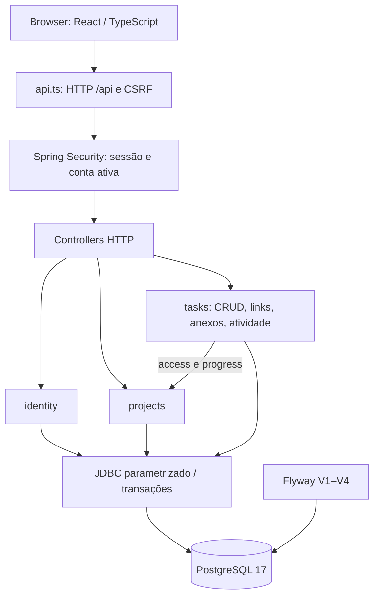
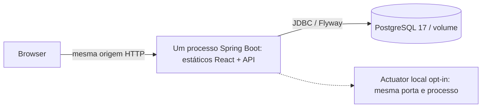
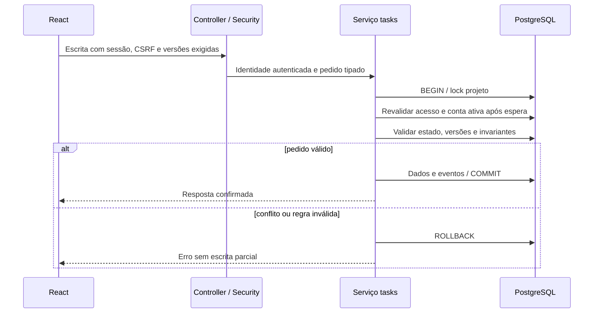

# Matriz — Arquitetura atual

**Leitura do código em 17-11-2026**, HEAD observado `778ffd1ff8cfa366b444edbb0cc21bcc9f9b28d2`. Documentação do âmbito académico aprovado pelo autor (ficha 03 e extensões de 13-11), não validação pelo cliente. Candidato `0.4.0-rc.1`, sem nova release. [Proveniência/arquivo V1](architecture/README.md), [dados/ER](database.md), [OpenAPI](../openapi.yaml) e [ADRs](adr/README.md).

## Desenho e responsabilidades

Monólito modular: Java **21**, Spring Boot **4.0.9**, React/TypeScript/Vite, PostgreSQL **17**, JDBC parametrizado e Flyway. O [POM](../backend/pom.xml) confirma Java/Boot; [Dockerfile](../Dockerfile) compila React com Node 22 e inclui estáticos no JAR. Não há deploy independente de módulos, ORM ou serviços distribuídos. Fronteiras são de código e disciplina, não isolamento de processos nem certificação por ferramenta de modularidade.

| Componente e fonte | Responsabilidade / dependências |
|---|---|
| [App](../frontend/src/App.tsx), Layout, Projects, Tasks | Sessão, navegação hash, cinco vistas (login, painel, projetos, projeto e tarefa), filtros e estados loading/vazio/erro/sucesso. `api.ts` centraliza `/api`, sessão/CSRF e erros; UI não decide autorização. |
| [TaskDetail](../frontend/src/TaskDetail.tsx), TaskDetailPanel | Mesmo detalhe em painel a partir da lista desktop >960 px; página no acesso direto/móvel. Rascunhos, foco/Escape/inert e mudança de layout sem inventar nova vista de produto. |
| MarkdownEditor / taskTemplates / TaskLinks / TaskAttachments / TaskActivity | Markdown básico, três templates fixos, relações, ficheiros, comentários e história. Usam API real, não mocks de produção; mocks existentes são de testes. |
| [identity](../backend/src/main/java/pt/matriz/identity/) | Conta ativa, login local, perfil/logout, scrypt, sessão/CSRF e limitação de tentativas. Usa JDBC para identidade; não tem registo público. |
| [ProjectService](../backend/src/main/java/pt/matriz/projects/ProjectService.java) / ProjectController | Dono de projeto/participação, gestor, CRUD, pesquisa, paginação e progresso derivado. Expõe `access`/`progress` internamente a tarefas. |
| [TaskService](../backend/src/main/java/pt/matriz/tasks/TaskService.java) / TaskController | CRUD, estado/prioridade/tipo/peso/motivo, atribuições e comentários; depende de projetos, anexos e atividade. |
| [TaskLinkService](../backend/src/main/java/pt/matriz/tasks/TaskLinkService.java) | Relações, duas versões e grafo BLOCKS; depende de projetos/tarefas/atividade. |
| [TaskAttachmentService](../backend/src/main/java/pt/matriz/tasks/TaskAttachmentService.java) / controller | Valida lotes, grava BYTEA e metadados; autoriza download/remoção, usa projetos e atividade. |
| [TaskActivityService](../backend/src/main/java/pt/matriz/tasks/TaskActivityService.java) | Insere eventos tipados na transação do chamador e lista história paginada; usa projetos/JDBC. Sem API de escrita externa. |
| [common](../backend/src/main/java/pt/matriz/common/) | DTOs tipados/presença de campos, validação Unicode/paginação/progresso, Problem Details. Não é um módulo de negócio adicional. |

O nó `tasks` agrupa serviços do mesmo pacote, não um serviço de rede. `common` é partilhado pelos módulos; não se desenha uma dependência inversa projetos→tarefas em Java, embora o SQL de projetos consulte contagens de tarefas.

## Deployment e operação

[Compose base](../compose.yaml) executa app e DB; [Dockerfile](../Dockerfile) tem build multi-stage e utilizador runtime não root. Publicações no host em loopback; app escuta em `0.0.0.0` dentro do contentor. Vite separado com proxy é apenas desenvolvimento, não um segundo frontend de produção.

[Observabilidade](../backend/src/main/resources/application-observability.yaml) desligada por omissão: só perfil local `observability`, health/probes mínimos anónimos e métricas `jvm.*`/`http.server.requests` autenticadas. Liveness não testa DB; readiness usa JDBC. Compose base verifica `/`, **não readiness**; [override](../compose.observability.yaml) verifica readiness. Sem monitoring externo, listener separado ou perfil Render. Procedimentos e limites em [README](../README.md#observabilidade-local--opt-in).

O Blueprint Render existente tem `checksPass`; uma ação remota pode provocar deploy. URL/disponibilidade/expiração registados noutros documentos não foram verificados ao vivo aqui. Nenhum novo destino ou operação remota é autorizado por este diagrama.

## Fluxos e consistência

1. **Login:** obter CSRF → enviar credenciais locais → validar conta ativa/hash scrypt → renovar ID da sessão; frontend consulta perfil, não guarda credenciais em localStorage. Escritas obtêm token atual, inclusive após login/logout.
2. **Listar:** autenticar/validar participação → ler página de projetos ou tarefas em `REPEATABLE_READ` → devolver resultados e agregados globais coerentes. Pesquisa de projetos por nome; tarefas filtradas por estado/prioridade. Ordenação estável `(created_at,id)`. `totalItems` filtrado pode diferir de `progress.total`.
3. **Escrever tarefa/relação/anexo/comentário:** transação → lock da linha existente do projeto → revalidar participação/permissão e conta ativa após espera → validar versão/regras → gravar dados e atividade → commit. Ver `TaskService.lockProject`; não extrapolar esta revalidação específica para todos os métodos de projetos.
4. **Concorrência:** projeto/tarefa exigem versão nas edições/eliminações; atribuições exigem versão da tarefa. Relação explícita exige versões atuais dos dois extremos. Conflito 409 não sobrepõe dados. Lock serializa grafo/contagem/revogação no projeto, sem distribuí-los por serviços.
5. **UI:** guarda síncrona e estado ocupado evitam submissões repetidas. Erro conserva texto; falha de transporte deixa resultado incerto, sem retry automático de escrita. Refetch externo não avança base suja; só resposta local de atribuição/relação reconhecida e correspondente à versão de partida pode avançá-la. Recuperar versão atual ou sair com rascunho exige confirmação.

## Regras atuais das extensões

- UUID continua identidade estável; `MAT-n` é chave global sequencial com lacunas. TASK/BUG/IMPROVEMENT; peso null ou 1/2/3/5/8/13; motivo opcional COMPLETED/CANCELLED/DUPLICATE/WONT_DO apenas em DONE. Todo DONE conta, sem ponderação.
- PUT mantém título/estado/prioridade/versão obrigatórios; descrição omitida/null dá vazio. Tipo/peso omitidos preservam; type null explícito é inválido, weight null limpa. Motivo omitido preserva em DONE→DONE, entrada em DONE sem motivo dá null, reabertura limpa. PUT aceite incrementa versão mesmo sem alteração efetiva; nesse caso não emite evento.
- RELATED é simétrica/canónica; BLOCKS/DUPLICATES dirigidas, no mesmo projeto, sem auto-relação/duplicados do mesmo tipo/direção. Só BLOCKS proíbe ciclos. B pode iniciar com bloqueadores; concluir B exige todos os bloqueadores diretos DONE. Reabrir A é recusado se algum dependente direto estiver DONE; não criar bloqueador não DONE para dependente DONE.
- POST/DELETE explícito de relação incrementa ambas as versões uma vez. POST repetido com versões atuais é idempotente (200, sem evento/incremento). Remover relação/eliminar bloqueador desbloqueia sem mudar estados; cascata da tarefa regista remoção no sobrevivente sem alterar a sua versão/datas.
- Anexos: 5 diretos/tarefa e, independentemente, 5/comentário, 1–4 194 304 bytes cada. BYTEA PostgreSQL; lote validado antes de gravar. PNG/JPEG/GIF/WebP/PDF/TXT/Markdown com validação limitada de extensão/MIME/assinatura; UTF-8 estrito sem NUL/markup ativo nos textuais. Não é antivírus, parsing completo nem certificação PDF.
- Comentário JSON ou multipart (`comment` application/json, `files` repetidos), texto obrigatório 1–2 000 pontos de código; lote/comentário/evento atómicos. Sem edição/eliminação isolada ou upload posterior. Comentários/anexos não mudam versão/updatedAt da tarefa.
- História: oito tipos de evento, ator/data do servidor, old/new tipados; título/descrição só flags, comentário só referência e metadados de anexos. Sem cópias de conteúdo/backfill/API de escrita; cascatas eliminam a história da tarefa, snapshots sobreviventes não dependem de FKs aos recursos removidos.
- Markdown básico por react-markdown 10.1.0, só HTTP/HTTPS, sem HTML/imagens/GFM. Três templates fixos; confirmação antes de substituir descrição não vazia, mudar tipo não aplica template.

## Segurança, migrations e limites

[SecurityConfig](../backend/src/main/java/pt/matriz/identity/SecurityConfig.java) mantém sessão no servidor e CSRF inclusive no login. Cookie HttpOnly/SameSite Strict, Secure configurável para HTTPS e timeout inativo de 30 minutos; reinício perde sessões e o throttle em memória. Cinco falhas por email/endereço em 15 minutos bloqueiam 15 minutos. Sem registo público, recuperação de palavra-passe ou CORS aberto.

Gestor gere projeto/membros/atribuições; participantes ativos gerem tarefas/relações/comentários e adicionam anexos. Só autor ou gestor **ainda participante** elimina ficheiro. Download revalida acesso, devolve attachment/nosniff/no-store. API recusa recurso alheio/inexistente com 404 indistinguível e gestão sem permissão com 403. FKs/validações/locks complementam-se; esconder botões não é autorização.

Flyway aplica V1–V4; [modelo atual](database.md) descreve a evolução. V4 é aditiva, preserva UUIDs/datas/versões e não inventa atividade anterior. Seed opt-in sem reinicialização; não alterar migrations já aplicadas, apagar volumes ou assumir rollback de schema por rollback de imagem. Boot 4 mantém Jackson 3 com defaults de compatibilidade documentados nas [release notes](../RELEASE_NOTES.md).

Limites aprovados: projeto 1–120, tarefa 1–200, descrição até 2 000 pontos de código; autorização e normalização no servidor. Produção diferida; retenção anual é pressuposto sem policy/âmbito/início, sem purga. Capacidade BYTEA/história, backups/recuperação, escala/p95 e operação prolongada exigem decisão.

[Resultados de 13-11 documentados](verification.md#validação-final-local-das-extensões--execução-de-13-11-2026): 41/43/6 e scans locais, **não reexecutados nem certificados nesta escrita**. Prova CI atual/falha controlada/uploads/retenção reais, revisão independente/humana e aceitação do cliente continuam pendentes. Não se reivindicam auditoria de segurança, WCAG integral ou prontidão de produção. [Wireframe atual](ui/wireframe.svg) é representação documental, não prova visual de execução.

## Comparação de alternativas e DEC-01

A comparação monólito simples/modular/microserviços e a decisão textual **DEC-01** estão preservadas no [arquivo integral V1, secções 2 e 3](architecture/v1/architecture.md#2-comparação-de-alternativas). DEC-01 é a designação histórica, não um novo número ADR. A decisão duradoura e a stack estão no [ADR-0001](adr/0001-modular-monolith-and-stack.md).

## Histórico

[V1 — documento completo encontrado em 17-11-2026](architecture/v1/architecture.md): inclui implementação de 13-11 e o Architecture Pack histórico da ficha 02. **Não é uma baseline pura da ficha 02.** As suas afirmações de resultados/estado são históricas; não anulam [evidência e pendências atuais](verification.md#extensões-de-tarefas--13-11-2026).

Em 17-11-2026, após a organização T1/T2 com uma cópia documental V2 separada, o utilizador preferiu manter a informação atual nos caminhos canónicos. O conteúdo completo foi consolidado aqui e a cópia separada removida, sem alterar regras, diagramas, contrato ou ADRs. Não foi criada uma V3 documental.
