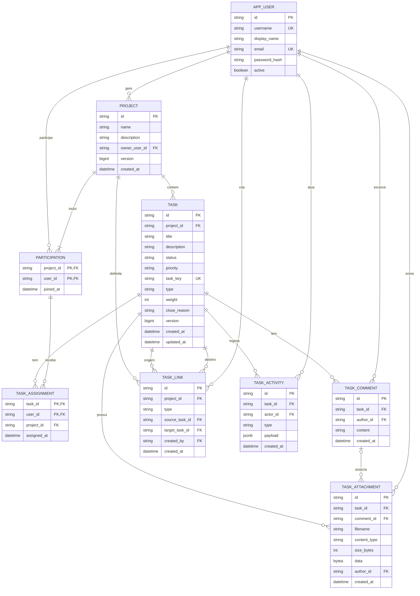

# Matriz — Modelo de dados atual

Confronto estático em **17-11-2026** com [migrations V1–V4](../backend/src/main/resources/db/migration/), serviços JDBC e [OpenAPI](../openapi.yaml). [Arquitetura](architecture.md) e [índice/proveniência](architecture/README.md). A consolidação documental não altera a migration SQL V2.

## Evolução física confirmada

| Migration | Efeito persistido |
|---|---|
| V1 `initial_schema` | app_user, project, participation, task, task_assignment e task_comment; password_hash inicialmente obrigatório; prioridade e responsáveis N:M já físicos. |
| V2 `retire_local_passwords` | Torna password_hash anulável para a integração OIDC anterior, sem apagar hashes. Estado histórico mantido na cadeia Flyway, não autenticação atual. |
| V3 `local_email_password_auth` | Email VARCHAR(254), índice único case-insensitive parcial (email não null) e password_hash alargado a VARCHAR(255) para login local; contas ativas precisam de email/hash válidos. |
| V4 `task_extensions` | Sequência/chave MAT, tipo/peso/motivo, task_link, task_attachment BYTEA, task_activity JSONB e integridade/índices associados. |

V4 atribui `MAT-n` às tarefas existentes por `(created_at,id)`, prepara a próxima chave global, impõe NOT NULL/UNIQUE; lacunas são permitidas. Mantém UUID gerado pela aplicação (coluna física VARCHAR(80)), datas e versões; sem backfill de eventos. Sequência não é identidade substituta de `id`.

### Registo académico — 17-11-2026

RF-17 reutiliza `app_user` e o índice único parcial `app_user_email_lower_unique` da **V3**; não exige nova migration, tabela, dependência ou alteração V4. [IdentityService](../backend/src/main/java/pt/matriz/identity/IdentityService.java) insere em transação UUID aleatório como id, username interno `registered-<UUID>`, nome aparado, email trim/lowercase, hash scrypt e `active=true`. `id`/username mantêm unicidade por constraints; não são escolhidos pelo visitante. Nome 1–120 pontos de código, email máximo 254 unidades UTF-16 normalizadas/regex compatível com login Unicode, password 12–200 pontos sem trim/composição, espaços permitidos. Só hash é persistido, não confirmação/password em claro.

`ON CONFLICT (lower(email)) WHERE email IS NOT NULL DO NOTHING` usa o índice V3: duplicado, incluindo concorrência, dá 409 explícito sem alterar conta/hash existente; outras falhas de integridade/DB não são mascaradas como email duplicado. Não insere projeto, participação ou privilégio herdado. Depois de login explícito a conta ativa pode criar projetos pelas permissões atuais. Conta ativa não prova posse do email: sem confirmação/envio de email/recuperação. Sucesso devolve só mensagem e não autentica. Decisão académica do autor, não cliente/produção/publicação.

Login conserva hashes existentes/passwords antigas curtas e até 200 pontos de código. Quotas de registo/login são independentes, só em memória por instância, não novas tabelas; registo conta 5 pedidos por endereço remoto observado/15 min após CSRF, sem confiar em forwarded cliente nem prometer IP real atrás de proxy. [Critérios US-20](user-stories.md#registo-académico--us-20) e [evidência/visual-E2E pendentes](verification.md#registo-académico--17-11-2026).

## Entidades, cardinalidades e integridade

| Tabela | Chaves, atributos e responsabilidade |
|---|---|
| app_user | `id` PK, username único, display_name, email com unicidade case-insensitive, password_hash anulável, active. Hash não sai na API. Sem endpoint de eliminação de contas. |
| project | `id` PK, name 1–120, description até 2 000, owner_user_id FK, version positiva, created_at TIMESTAMPTZ. Um único gestor derivado do proprietário, não papel global. |
| participation | PK `(project_id,user_id)`, FKs para projeto/utilizador, joined_at. Inclui gestor; FK composta de project `(id,owner_user_id)` para participation é DEFERRABLE INITIALLY DEFERRED. |
| task | `id` PK, project_id FK fixo, title 1–200, description até 2 000, status TODO/IN_PROGRESS/DONE, priority LOW/MEDIUM/HIGH, version positiva, created_at/updated_at; unique `(id,project_id)`. Inicial TODO/MEDIUM, versão 1. |
| task — V4 | task_key única global, type TASK/BUG/IMPROVEMENT inicial TASK, weight null ou 1/2/3/5/8/13, close_reason null ou COMPLETED/CANCELLED/DUPLICATE/WONT_DO só em DONE. |
| task_assignment | PK `(task_id,user_id)`, project_id, assigned_at; FKs compostas para task `(id,project_id)` e participation `(project_id,user_id)`. Zero ou vários responsáveis, sem duplicação. |
| task_comment | `id` PK, task_id FK, author_id FK app_user, content 1–2 000, created_at; unique `(id,task_id)` desde V4. Autor/data do servidor. |
| task_link | `id` PK, project_id FK, type RELATED/BLOCKS/DUPLICATES, source_task_id/target_task_id com FKs compostas para tarefas do mesmo projeto, created_by FK app_user, created_at. Sem auto-relação; unique `(type,source,target)`; RELATED exige source<target. |
| task_attachment | `id` PK, task_id FK, comment_id opcional, filename, content_type, size_bytes 1–4 194 304, data BYTEA com octet_length=size_bytes, author_id FK app_user, created_at. FK composta `(comment_id,task_id)` garante comentário da mesma tarefa. |
| task_activity | `id` PK, task_id FK, actor_id FK app_user, created_at, type e payload JSONB. Tipos TASK_CREATED/TASK_UPDATED/ASSIGNEES_CHANGED/COMMENT_ADDED/LINK_ADDED/LINK_REMOVED/ATTACHMENT_ADDED/ATTACHMENT_REMOVED. |

`email UK` representa o índice sobre lower(email), não unicidade case-sensitive da coluna. `datetime` no desenho representa TIMESTAMPTZ físico/instante UTC no contrato. A participação obrigatória do gestor e as FKs compostas são invariantes adicionais à leitura simplificada do ER. Cada anexo pertence a uma tarefa e opcionalmente a um comentário; um comentário pode ter zero a cinco ficheiros.

## Regras de serviço e concorrência

O SQL garante integridade referencial, enums, unicidade e limites físicos, mas **não** conta ativa, autorização, máximo de cinco anexos, aciclicidade BLOCKS ou estado dos bloqueadores. [TaskService](../backend/src/main/java/pt/matriz/tasks/TaskService.java), [TaskLinkService](../backend/src/main/java/pt/matriz/tasks/TaskLinkService.java) e [TaskAttachmentService](../backend/src/main/java/pt/matriz/tasks/TaskAttachmentService.java) validam essas regras em transação com lock do projeto e revalidação de participação/permissão/atividade da conta após espera.

- Gestor gere membros/atribuições; remover membro com atribuições (mesmo DONE) é recusado, assim como remover gestor. FK não substitui verificação de elegibilidade ativa.
- RELATED é simétrica com extremos canónicos; BLOCKS/DUPLICATES são dirigidas. Só BLOCKS impede ciclos; concluir exige bloqueadores diretos DONE; reabrir bloqueador com dependente direto DONE é recusado. Remover link/eliminar bloqueador não muda estados.
- Versão otimista: PUT aceite incrementa tarefa mesmo sem mudança efetiva; sem mudança não há evento. Atribuição repetida atual não incrementa. Criação/remoção explícita de link exige ambas as versões e incrementa ambas uma vez; POST repetido com versões atuais não altera nada. Cascata de tarefa não incrementa extremo sobrevivente.
- Comentários JSON/multipart e anexos são atómicos com eventos, sem mudar versão/updatedAt da tarefa; cinco diretos por tarefa e cinco por comentário, independentemente. Texto obrigatório; sem edição/eliminação isolada do comentário nem upload posterior.
- Histórico guarda valores tipados, ator/data e flags de alteração de título/descrição, não cópias de textos. COMMENT_ADDED referencia comentário e metadados dos anexos num evento, sem duplicar uploads. Snapshots de link/anexo removido não têm FK ao recurso já removido.
- Limites Unicode aplicados pelo código, sem truncagem; títulos/nomes/comentários normalizam espaços nas extremidades, descrição não. No contrato PUT, omissão/presença/null dos novos campos têm a semântica descrita na [arquitetura](architecture.md#regras-atuais-das-extensões).

## Eliminação, índices e dados derivados

Eliminar projeto remove tarefas/participações; o serviço remove primeiro atribuições para respeitar FKs. Eliminar tarefa remove atribuições/comentários/links/anexos/atividade; eliminar comentário em cascata elimina os seus ficheiros. Isto não disponibiliza API isolada de eliminação de comentários. Autores/atores apontam para app_user e não participation, conservando autoria após remoção de membro. Snapshots históricos do extremo sobrevivente ficam sem mudar a sua versão/estado/datas.

Índices suportam `(project_id,created_at,id)` nas tarefas, participação por utilizador, atribuições por participante, comentários/links/anexos/atividade na ordenação da consulta. Não se afirma que estes índices provem desempenho sob carga.

Contagens/progresso não são colunas duplicadas: agregam todas as tarefas do projeto, todo DONE conta, sem ponderar peso/motivo. Sem tarefas 0%; restantes 100×done/total arredondado com meios para cima (1/8→13%, 2/3→67%). Listagens em `REPEATABLE_READ`, paginação ordenada por `(created_at,id)`; filtros afetam `totalItems`, não agregados.

RF-01/17→app_user; RF-02/03/04/10→project/participation; RF-05/06/08/09/10/12→task; RF-07→task_assignment; RF-11→task_comment; RF-13→task_link; RF-14→task_attachment; RF-15→task_activity. RF-16 usa strings existentes, sem nova tabela de templates.

## Operação e limitações

Flyway mantém checksums; não editar migrations aplicadas. Seed fictício opt-in, transação/lock de inicialização e sem reinicializar dados/credenciais. Sessões/throttle em memória não são tabelas persistentes deste modelo; reiniciar não conserva sessão.

BYTEA aumenta base/backups; 4 MiB por ficheiro **não é** limite global de armazenamento. Validação de formato/MIME é limitada, não antivírus ou certificação PDF. Capacidade, backups/recuperação e retenção continuam pendentes; um ano é pressuposto sem policy/âmbito/evento inicial, sem purga automática. Reverter imagem não reverte schema/dados.

[Verificação de 13-11 documentada](verification.md#validação-final-local-das-extensões--execução-de-13-11-2026) relata migração populada V3→V4, instalação vazia, persistência de dados/bytes após recriação e outage/recovery. Não reexecutada nesta tarefa nem prova de backup/restore ou produção. ER conferido estaticamente; não se afirma renderização Mermaid ou auditoria independente.

## Histórico e navegação

- [Índice de versões, proveniência e hashes](architecture/README.md).
- [V1 — documento integral encontrado em 17-11-2026](architecture/v1/database.md): mistura schema implementado V4 e modelo lógico histórico da ficha 02; **não é baseline original da ficha 02**.
- [Contrato OpenAPI atual](../openapi.yaml), [ADR-0003](adr/0003-postgresql-jdbc-flyway.md) e [verificação](verification.md#extensões-de-tarefas--13-11-2026).

O arquivo conserva regras substituídas (responsável único e ausência de eliminações) como histórico, não como regras atuais. Capacidade, backups/recuperação e política de retenção continuam pendentes; esta organização documental não os valida.

Em 17-11-2026, após a organização T1/T2, o utilizador preferiu consolidar neste caminho canónico o modelo completo antes designado V2 documental e remover a cópia separada. Migrations SQL V1–V4, ER e regras mantidos.
