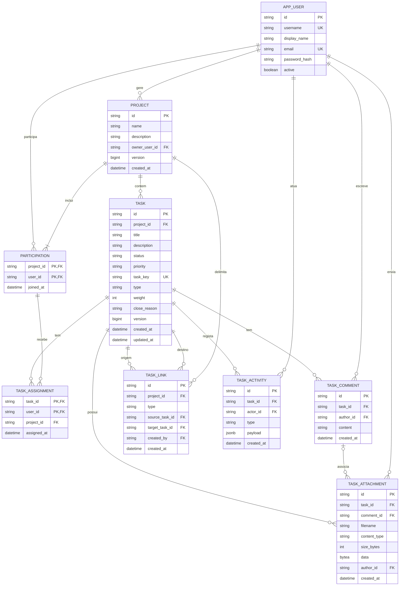
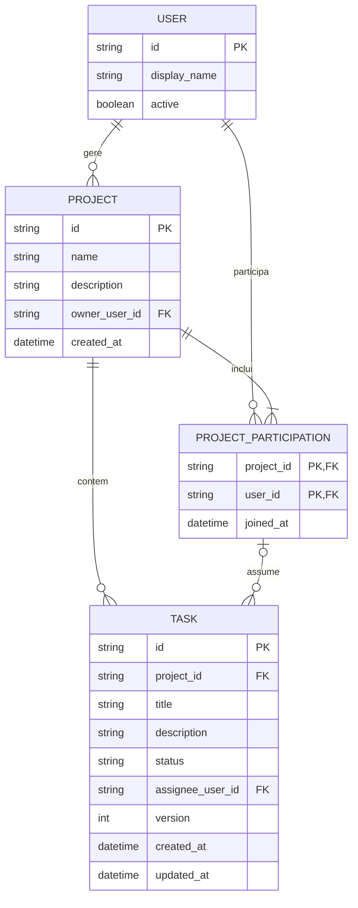

# Matriz — Modelo lógico de dados e diagrama ER

## Modelo implementado — ficha 03 e V4

PostgreSQL 17, migrations Flyway `backend/src/main/resources/db/migration/V1__initial_schema.sql` a `V4__task_extensions.sql`. A implementação usa os nomes físicos abaixo. Este modelo substitui o responsável único e a ausência de credenciais/comentários/prioridade do desenho inicial.

| Tabela | Atributos e regras principais |
|---|---|
| `app_user` | id opaco, username único usado como referência de demonstração, display_name, email com índice único case-insensitive, password_hash scrypt anulável para compatibilidade com perfis antigos e active. |
| `project` | id, name 1–120, description até 2 000, owner_user_id, version positiva, created_at UTC. Proprietário é gestor por projeto. |
| `participation` | PK composta (project_id,user_id), joined_at; inclui gestor. FK composta diferível do projeto obriga o gestor a participar. |
| `task` | id UUID estável, project_id fixo, title 1–200, description até 2 000, status, priority, version, created_at e updated_at; task_key global única, type, weight null e close_reason null. Inicial TODO/MEDIUM/TASK, versão 1. |
| `task_assignment` | PK (task_id,user_id), project_id e assigned_at; FK composta para tarefa/projeto e participação/projeto. Zero ou vários responsáveis. |
| `task_comment` | id, task_id, author_id, content 1–2 000, created_at; autor e data do servidor. |
| `task_link` | id, project_id, type, source_task_id, target_task_id, created_by, created_at; FKs compostas dos dois extremos a task(id,project_id), sem auto-relação, unique(type,source,target), RELATED com source<target. |
| `task_attachment` | id, task_id, comment_id null para direto, filename, content_type, size_bytes 1–4 194 304, data BYTEA com octet_length=size_bytes, author_id e created_at; FK composta (comment_id,task_id) para comentário da mesma tarefa. |
| `task_activity` | id, task_id, actor_id, created_at, type e payload JSONB; oito tipos de evento, índice (task_id,created_at,id), apenas inserção/leitura pela aplicação, sem API de edição/eliminação. |

V4, aprovada pelo autor em **13-11-2026**, cria `task_key_sequence` e atribui `MAT-n` a tarefas existentes por `(created_at,id)`, prepara a próxima chave global e impõe unicidade/not-null. Lacunas são permitidas; UUID, datas e versões existentes não mudam. Type TASK/BUG/IMPROVEMENT inicial TASK; weight null ou 1/2/3/5/8/13; close_reason null ou COMPLETED/CANCELLED/DUPLICATE/WONT_DO apenas se status DONE. Não há backfill de atividade fictícia.

FKs de links/anexos/atividade fazem cascata com a tarefa; comentário elimina os seus ficheiros por FK composta. Ator/autor aponta para app_user, não participação, mantendo autoria após remoção de membro; a API não elimina contas. Payloads históricos de relação/ficheiro não têm FK aos recursos removidos: conservam metadados no extremo sobrevivente, sem copiar títulos/descrições/comentários/bytes. COMMENT_ADDED guarda uma referência e array de metadados dos anexos, sem eventos de upload duplicados.

SQL não garante aciclicidade BLOCKS, estados de todos os bloqueadores, conta ativa ou máximo de cinco ficheiros. Os serviços validam essas regras com lock transacional da linha do projeto e revalidação de acesso/atividade após espera; count+lote+histórico são atómicos. Criação/remoção explícita de link incrementa as duas versões; cascata de tarefa não altera estado/versão/datas do sobrevivente. Comentários/anexos não alteram versão/updatedAt.

BYTEA faz crescer armazenamento e backups PostgreSQL; capacidade, recuperação e policy de retenção continuam pendentes, sem autosweep. Limites de MIME/assinatura/texto são validação limitada, não certificação PDF/antivírus. A evidência final confirma V3 populada→V4/MAT/defaults no Maven e instalação vazia da imagem fresca; após recriar app/db, ambos IDs mudaram no mesmo volume, com snapshots SQL/HTTP, relações/comentários e bytehashes iguais. Paragem/retoma só da DB própria também preservou os dados; app/db próprios terminaram parados, volume retido. São [resultados locais guardados](verification.md#validação-final-local-das-extensões--execução-de-13-11-2026), não execuções desta escrita nem validação de backups/produção ou aceitação humana.

V1 definiu `password_hash`; V2 permitiu NULL durante a integração OIDC anterior, sem apagar hashes. V3 adiciona email e índice único case-insensitive para o login local atual. Apenas contas ativas com email e hash válidos podem autenticar. O seed cria contas fictícias e hashes scrypt se ainda não existirem, sem substituir credenciais existentes nem reinicializar os dados. Não existe processo automático de purga; retenção de um ano é apenas um pressuposto provisório, sem âmbito nem evento inicial definidos.

Uma atribuição refere exatamente uma participação do mesmo projeto. Não guardar `assignee_user_id` em task: o DTO atual contém uma lista `assignees`. A referência ao autor do comentário é a utilizador, não a participação, para preservar autoria após remoção de membro. A conta não é eliminada pela API.

Projeto/tarefas podem ser eliminados com dependentes por cascata transacional, conforme autorização da ficha 03. A remoção isolada de participação continua bloqueada por atribuições, incluindo concluídas; proprietário não pode ser removido. Verificar conta ativa na atribuição — FKs não garantem essa regra.

O código valida pontos de código Unicode e espaços antes da escrita; PostgreSQL impõe limites de coluna, unicidade, enums e FKs adicionais. As edições comparam versão atomicamente; o bloqueio de projeto serializa escritas de participação/atribuição/tarefas. Contagens e progresso são derivados, nunca guardados como verdade duplicada.

O seed opt-in usa uma transação e lock de inicialização; se a conta de demonstração inicial já existe, não reinicializa dados nem palavras-passe. Migrations têm histórico de checksums Flyway e não recriam o schema em cada arranque.

Rastreabilidade: app_user → RF-01; project/participation → RF-02/03/04/10; task → RF-05/06/08/09/10; task_assignment → RF-07; task_comment → RF-11. Datas são instantes com timezone, representadas em UTC no contrato.

Extensões: task_key/type/weight/close_reason → RF-12; task_link → RF-13; task_attachment → RF-14; task_activity → RF-15; descrição/comentário continuam strings para RF-16. O diagrama é documentação textual do schema, não renderização Mermaid validada nesta tarefa.

Modelo lógico da ficha 02 — histórico; cardinalidade de responsável e proibição de eliminações foram substituídas

## 1. Estado e princípios

Exercício 2 da ficha 02. Modelo lógico proposto para o [MVP](requirements.md), alinhado com a [arquitetura](architecture.md). Não existe base de dados criada, SQL, migrations ou motor escolhido.

As cardinalidades seguem os pressupostos P-01 a P-10 de [constraints.md](constraints.md), não uma aprovação do cliente. Os identificadores são opacos; `string` representa texto conceptual, não uma escolha física de coluna. Datas representam instantes; a API usa representação UTC.

## 2. Entidades e atributos

| Entidade | Atributos conceptuais | Justificação |
|---|---|---|
| USER | `id` (PK), `display_name` (texto obrigatório), `active` (booleano obrigatório). | Identificar participantes e verificar elegibilidade, RF-01/RF-04. |
| PROJECT | `id` (PK), `name` (texto 1–120 após normalização), `description` (texto até 2 000, vazio se omitido), `owner_user_id` (FK obrigatória para USER), `created_at` (instante). | Organizar trabalho e identificar o único gestor, RF-02/RF-03. |
| PROJECT_PARTICIPATION | `project_id` (PK/FK para PROJECT), `user_id` (PK/FK para USER), `joined_at` (instante). | Relação N:M entre projetos e utilizadores, incluindo o gestor, RF-04. |
| TASK | `id` (PK), `project_id` (FK obrigatória), `title` (texto 1–200 após normalização), `description` (texto até 2 000, vazio se omitido), `status` (TODO/IN_PROGRESS/DONE), `assignee_user_id` (opcional), `version` (inteiro positivo), `created_at` e `updated_at` (instantes). | Trabalho, responsável único, estados e concorrência, RF-05 a RF-08. |

`display_name` não é um identificador único. Não se impõem nomes únicos a projetos ou tarefas. Os valores iniciais de TASK são `TODO`, responsável ausente e versão 1; os restantes metadados são gerados pela aplicação.

Não se modelam tokens de sessão, anexos, datas-limite ou sprints. O hash nunca é exposto pela API; sessões são mantidas pelo Spring Security no servidor.

O papel no projeto é derivado: se `PROJECT.owner_user_id` corresponde à pessoa, é gestor; os restantes participantes são membros. Não se guarda uma coluna de papel que possa contradizer o proprietário.

## 3. Relacionamentos e cardinalidades

| Relação | Cardinalidade e obrigatoriedade |
|---|---|
| USER gere PROJECT | Um utilizador gere zero ou muitos projetos; cada projeto tem exatamente um gestor. |
| PROJECT contém PROJECT_PARTICIPATION | Um projeto tem uma ou mais participações, incluindo a do gestor; cada participação pertence a um projeto. |
| USER tem PROJECT_PARTICIPATION | Um utilizador tem zero ou muitas participações; cada participação refere exatamente um utilizador. |
| PROJECT contém TASK | Um projeto tem zero ou muitas tarefas; cada tarefa pertence exatamente a um projeto. |
| PROJECT_PARTICIPATION assume TASK | Uma participação pode ser responsável por zero ou muitas tarefas do seu projeto; uma tarefa tem zero ou uma participação responsável. |

## 4. Diagrama ER em Mermaid

A relação de responsável é composta: `(TASK.project_id, TASK.assignee_user_id)` referencia `(PROJECT_PARTICIPATION.project_id, PROJECT_PARTICIPATION.user_id)`. A marca FK em `assignee_user_id` não significa uma referência isolada a qualquer utilizador. Se não há responsável, só `assignee_user_id` está ausente; a tarefa continua a ter projeto.

## 5. Integridade e transações

- Chaves primárias únicas e não nulas; participação única pelo par `(project_id, user_id)`.
- Todo o proprietário tem de ter participação no seu próprio projeto. Criar PROJECT e a participação inicial numa única transação. A inclusão do proprietário é uma invariável adicional que uma simples FK para USER não garante.
- A referência composta do responsável impede atribuições a outro projeto; verificar também que a conta está ativa no momento da atribuição, pois uma FK não garante elegibilidade.
- A inatividade posterior de uma conta não elimina automaticamente a participação ou atribuições históricas. Impede o acesso e novas atribuições; o gestor pode retirar/substituir a atribuição para remover a participação. Não se inventa uma transferência automática.
- Recusar a remoção de uma participação referenciada por qualquer tarefa, incluindo concluída; recusar sempre a remoção do gestor.
- Serializar operações concorrentes sobre participação/atribuição do mesmo projeto numa transação local, sem intervalo entre verificar e escrever. Validar igualmente a participação nas operações de leitura e criação.
- Não usar eliminação em cascata de projetos, utilizadores, participações ou tarefas para contornar estas regras. Eliminação de projetos/tarefas não é uma funcionalidade do MVP.
- Estado limitado aos três valores; títulos e nomes normalizados conforme RN-02/RN-05; descrições não são truncadas nem normalizadas.
- `version` começa em 1 e é comparada na escrita; alterações efetivas incrementam-na atomicamente, com `updated_at`. O mecanismo físico fica para a implementação; não basta comparar duas leituras fora da transação.

A presença obrigatória do proprietário na participação forma uma dependência lógica entre os dados criados em conjunto. A estratégia física para garantir esta invariável e as FKs deve ser escolhida com o SGBD; não é alegado que o diagrama, por si só, a imponha. Testar criação parcial, remoção do gestor e operações concorrentes antes da implementação ser aceite.

## 6. Dados derivados e representação na API

Não guardar contagens nem percentagens em PROJECT: calcular a partir de todas as TASK desse projeto, agrupadas por estado. A soma das três contagens tem de coincidir com o total.

| Elemento lógico | Representação no contrato |
|---|---|
| `PROJECT.id`, `name`, `description` | `project.id`, `project.name`, `project.description`. |
| Perfil derivado para a pessoa autenticada | `project.currentRole`: `MANAGER` ou `MEMBER`. |
| TASK e referência do projeto | `id`, `projectId`, `title`, `description`, `status`, `version`, `createdAt`, `updatedAt`. |
| Participação responsável e USER | `assignee: null` ou `{ userId, displayName }`; nome obtido por consulta, não duplicado na tarefa. |
| Contagens de todas as tarefas do projeto | `progress.total`, `todo`, `inProgress`, `done`, `completedPercent`. |

Sem tarefas, percentagem 0. Nos restantes casos, arredondar 100 vezes concluídas/total ao inteiro mais próximo, com meios para cima; não usar uma política que arredonde meios para o inteiro par. Os resultados esperados incluem 1/3 → 33%, 2/3 → 67%, 1/8 → 13% e 2/5 → 40%.

Paginação e agregados do GET devem refletir o mesmo retrato consistente. `totalItems` conta todas as tarefas do projeto e coincide com `progress.total`; não deve contar só a página.

## 7. Rastreabilidade e limitações

USER suporta RF-01; PROJECT e a propriedade suportam RF-02/RF-03; PROJECT_PARTICIPATION suporta RF-04 e a autorização transversal; TASK suporta RF-05/RF-06/RF-07/RF-08; a consulta derivada suporta RF-09.

Ficam por confirmar com o cliente cardinalidades, permissões e limites de conteúdo. Identidade, estratégia física de integridade, índices, retenção, eliminação administrativa e recuperação aguardam decisões técnicas e de negócio. Não foram criadas entidades especulativas para resolver necessidades ainda não aprovadas.

